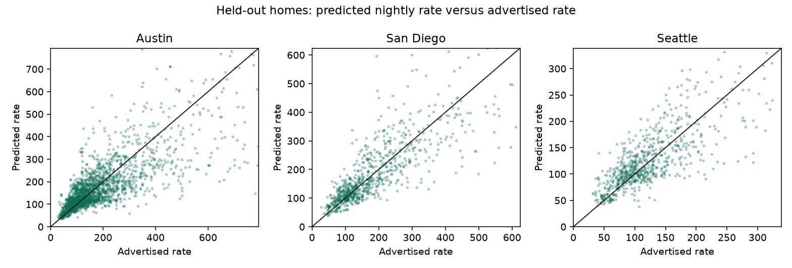
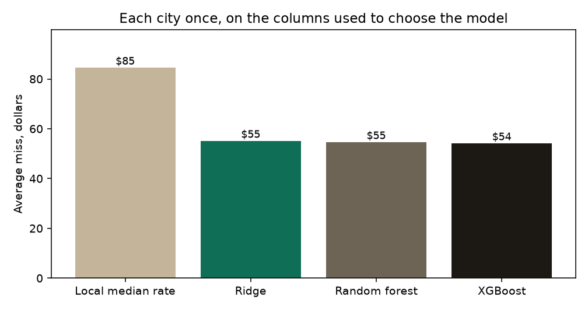
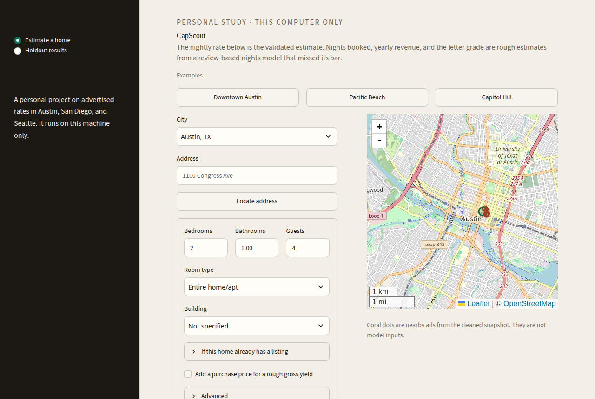
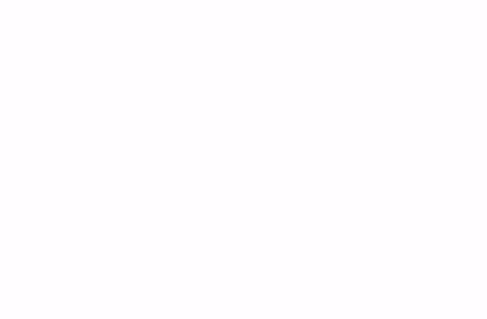

# CapScout

[](https://github.com/corbinsz/CapScout/actions/workflows/ci.yml)

CapScout grades a home in Austin, San Diego, or Seattle as a short-term rental. It predicts the nightly rate the home could advertise. Nights booked and yearly revenue are shown as rough estimates: the nights figure is built from reviews, not from a count of bookings, and it missed a bar that was set before the test. The letter grade ranks that rough revenue inside the city. It is not a profit grade.

This is a personal project, built in spare time. It runs on your computer.

## Run it locally

From the repository root:

```bash
pip install -r requirements.txt && python -m app.launch
```

That installs the libraries, downloads the three Inside Airbnb snapshots the first time, and opens the app on this machine at port 8501.

The listings are Inside Airbnb snapshots, CC BY 4.0, credit Inside Airbnb. Austin is the 2025-09-16 snapshot. San Diego and Seattle are the 2025-03-16 snapshots. The longer source notes are in [DATA.md](DATA.md).

## The holdout, in one table

The shipped nightly-rate model is ridge regression, a linear model, after one pre-registered feature addition. Quote the first row. The city rows and the each-city-once row are the detail. Seattle's interval resamples only 8 held-out cells. The full intervals, the error slices, and why the model looks like this are in [reports/FINDINGS.md](reports/FINDINGS.md). A one-page way to explain the work out loud is [docs/EXPLAIN_IT_YOURSELF.md](docs/EXPLAIN_IT_YOURSELF.md).

| City | R² | Average miss | Median error | Less error than the local median rate |
| --- | ---: | ---: | ---: | ---: |
| Every home once | 0.555 | $60.13 | 23.0% | 36.9% |
| Austin, TX | 0.520 | $70.32 | 25.4% | 37.6% |
| San Diego, CA | 0.639 | $55.31 | 20.6% | 39.6% |
| Seattle, WA | 0.521 | $36.21 | 20.2% | 26.7% |
| Each city once | 0.560 | $53.95 | 22.1% | 36.2% |

Counting every holdout home once, the miss is $60.13 against $95.34 for the local median rate, which is 36.9% less error. The 95% interval on that gap, from resampling cells inside each city, is 33.8% to 42.1%. R² is 0.555 (0.492 to 0.663). The median error is 23.0% (20.6% to 25.4%). The holdout is 3,648 homes.









## The result

The holdout was frozen before any model was fit. Seed 17 holds out about 20% of 3 km grid cells in each city. A host with a held-out listing is removed from training, and so is any training home within 1 km of a held-out home. Seeds 19, 29, and 37 repeat the same frozen choice. They were not used to pick a feature or a model, and they were not re-run after the feature addition below.

Ridge was chosen on a shorter column list. The lowest average error was $54.19 a night, from XGBoost. Ridge regression was $55.18, inside the 2% band (up to $55.28), and it is the simplest model in that band.

A rule written before the next scores said to add three features only if grouped cross-validation on the training cells cut the equal-city average error by at least 2%. The three features are an inverse-distance index of a fixed public place list, distance to a fixed shoreline list in San Diego and Seattle, and bedrooms times guests. The bundle's training-cell error was $56.01 against $57.27, a 2.2% improvement, so it was adopted. The holdout above is the one score after that adoption. The comparison table below is the score that chose ridge, before those columns existed.

Average miss on that earlier holdout, in dollars. Each city counts equally.

| Model | Austin, TX | San Diego, CA | Seattle, WA | Average |
| --- | ---: | ---: | ---: | ---: |
| Local median rate | $112.75 | $91.62 | $49.40 | $84.59 |
| Linear regression | $73.26 | $56.89 | $36.26 | $55.47 |
| Ridge regression | $72.13 | $57.27 | $36.13 | $55.18 |
| Random forest | $72.09 | $55.98 | $35.92 | $54.67 |
| XGBoost | $71.81 | $53.88 | $36.89 | $54.19 |

The same columns, before the added features, pooled two ways. Every home once is the first row. Seattle's part of the interval resamples 8 cells.

| City | R² | Average miss | Median error | Less error than the local median rate |
| --- | ---: | ---: | ---: | ---: |
| Every home once | 0.542 | $61.60 | 23.6% | 35.4% |
| Austin, TX | 0.511 | $72.13 | 25.9% | 36.0% |
| San Diego, CA | 0.601 | $57.27 | 21.5% | 37.5% |
| Seattle, WA | 0.522 | $36.13 | 19.9% | 26.9% |
| Each city once | 0.545 | $55.18 | 22.5% | 34.8% |

Ridge on those columns, primary holdout. The intervals resample held-out grid cells, not individual listings.

| City | Listings | Cells | R² | R² interval | MAE | MAE interval | Median % error | Median % interval | Local median MAE | Error removed |
| --- | ---: | ---: | ---: | ---: | ---: | ---: | ---: | ---: | ---: | ---: |
| Austin, TX | 2,101 | 31 | 0.511 | 0.449 to 0.665 | $72.13 | $56.38 to $85.13 | 25.9% | 22.7% to 28.1% | $112.75 | 36.0% |
| San Diego, CA | 817 | 23 | 0.601 | 0.517 to 0.673 | $57.27 | $45.40 to $75.88 | 21.5% | 19.2% to 24.5% | $91.62 | 37.5% |
| Seattle, WA | 730 | 8 | 0.522 | 0.489 to 0.592 | $36.13 | $31.43 to $40.24 | 19.9% | 17.3% to 22.4% | $49.40 | 26.9% |

The same ridge specification, still before the added features, on three other holdout seeds. The spread is the gap between the highest and lowest of those three.

| City | Primary R² | Other seeds R² | Primary MAE | Other seeds MAE |
| --- | ---: | ---: | ---: | ---: |
| Austin, TX | 0.511 | 0.455, 0.396, 0.574 (spread 0.178) | $72.13 | $54.41, $64.01, $49.60 (spread $14.41) |
| San Diego, CA | 0.601 | 0.650, 0.650, 0.182 (spread 0.468) | $57.27 | $69.37, $74.25, $62.31 (spread $11.94) |
| Seattle, WA | 0.522 | 0.465, 0.544, 0.492 (spread 0.079) | $36.13 | $39.79, $36.18, $32.46 (spread $7.33) |

San Diego's R² on those other seeds runs from 0.182 to 0.650. Those seeds describe the columns before the added features. Austin's primary dollar error on those columns ($72.13) is higher than its other seeds.

On the shipped model, 44.2% of held-out homes land within 20% of the advertised rate, against 29.6% for the local median rate. The top 10% of prices account for 38.7% of the absolute error, and ridge underpredicts them. The app's range covered 79.0% of Austin's holdout, 81.8% of San Diego's, and 81.5% of Seattle's. Those are the measured coverages. The band was not widened after that look.

## Booked nights

The nights label is not a booking count. It is a review-based estimate: reviews in the last year divided by 0.50, times 3 nights (or a longer minimum stay, up to 90), capped at 255.5 nights. The model cannot see the review count, the minimum stay, the price, or availability.

The lowest average error was 69.0 nights, from Random forest. Linear regression was 69.3 nights, inside the 2% band (up to 70.4 nights), and it is the simplest model in that band.

The nights model did not clear the pre-set bar in every city. The bar was an average miss at least 10% lower than the local median nights, and an R² of at least 0.10. The app labels nights as a rough estimate.

| Model | Austin, TX | San Diego, CA | Seattle, WA | Average |
| --- | ---: | ---: | ---: | ---: |
| Local median nights | 72.0 | 76.5 | 72.8 | 73.8 |
| Linear regression | 68.9 | 70.2 | 68.7 | 69.3 |
| Ridge regression | 68.6 | 70.3 | 68.8 | 69.2 |
| Random forest | 67.9 | 70.5 | 68.7 | 69.0 |
| XGBoost | 69.0 | 69.9 | 68.7 | 69.2 |

| City | R² | R² interval | MAE (nights) | MAE interval | Median % error | Local median MAE | Error removed | Cleared |
| --- | ---: | ---: | ---: | ---: | ---: | ---: | ---: | ---: |
| Austin, TX | 0.014 | -0.013 to 0.055 | 68.9 | 64.8 to 70.8 | 54.2% | 72.0 | 4.4% | No |
| San Diego, CA | 0.118 | 0.042 to 0.144 | 70.2 | 66.6 to 71.4 | 39.9% | 76.5 | 8.1% | No |
| Seattle, WA | 0.062 | -0.006 to 0.120 | 68.7 | 64.8 to 70.8 | 40.0% | 72.8 | 5.7% | No |

| City | Primary R² | Other seeds R² | Primary MAE | Other seeds MAE |
| --- | ---: | ---: | ---: | ---: |
| Austin, TX | 0.014 | 0.032, 0.033, 0.057 (spread 0.025) | 68.9 | 68.5, 65.8, 66.6 (spread 2.8) |
| San Diego, CA | 0.118 | 0.100, 0.095, 0.060 (spread 0.039) | 70.2 | 71.2, 70.8, 73.1 (spread 2.3) |
| Seattle, WA | 0.062 | 0.073, 0.063, 0.056 (spread 0.016) | 68.7 | 70.5, 71.7, 71.9 (spread 1.4) |

The nights models predict nights directly. On the training folds a log target averaged 73.76 nights of error against 71.84 for the direct target, which is not a 2% improvement, so the log target was not used.

Yearly revenue in the app is the predicted rate times the predicted nights. On the shipped holdout that product has R² 0.281 in Austin, 0.267 in San Diego, and 0.162 in Seattle. The letter grade matched the grade of the review-based revenue about 34%, 33%, and 34% of the time. The grade is a rank of that rough revenue. It is not a profit.

## Calendar panel

The nights model is weak because the label is a review proxy. A daily job watches a fixed panel of real calendars so a later model can train on nights that actually closed. The rules and the limits are in [docs/CALENDAR.md](docs/CALENDAR.md). The snapshots go to the `calendar-data` branch, compressed, so the study stays as it is.

What is collected: listings that still look active on the newest Inside Airbnb file for each city. Active means a review in the twelve months before that file and at least one open night in the next year. Those files are Austin dated 2026-09-17, and San Diego and Seattle dated 2026-09-20. The panel draw uses seed 17, the same number as this study's primary holdout, and it is a sample of listings, not that holdout. It is stratified by neighbourhood and room type. The ids are `data/calendar_sample.json`. The eligible rows behind the draw are `data/calendar_pool/`. Ids are stored as text, because the newer ones are longer than a floating-point number can hold. Once a day the job reads each listing's public availability calendar and appends `listing_id`, `date`, `available`, `min_nights`, `price` when the calendar includes one, and `fetched_at`. It waits about 2 seconds between listings, retries ordinary server errors with backoff, names itself in the user agent, and stops if the response is a block or a challenge page. There is no login, no captcha handling, and no proxy. If that public calendar cannot be read, the job stores Inside Airbnb's published `calendar.csv` for the same ids instead and says so in the run report. One published file cannot show a night flip, so that fallback is a supply snapshot, not a booked-night rate.

A probe on 2026-11-19 asked 36 of those ids in each city. The public calendar came back for 35 of 36 in Austin, 35 of 36 in San Diego, and 36 of 36 in Seattle. None failed, and the probe was not challenged. The panel is sized from that rate so about 300 calendars come back: 309 ids in Austin, 309 in San Diego, and 300 in Seattle. At the probe's pace a full pass is under an hour, inside the three-hour Actions job, so the daily run stays one job. GitHub Actions has not run it. The schedule starts from the default branch after this workflow is merged.

An earlier panel, 300 ids from the 2025 study files, returned a calendar for 80 Austin listings, 93 San Diego listings, and 92 Seattle listings on the same day. That pass is the 2026-11-19 files on `calendar-data`. It is not the panel being tracked. The label command keeps the current sample.

How a booking is inferred, once two or more snapshots exist:

- A night that was available and then unavailable, in a run of 1 to 13 nights, counts as booked when we still saw it open inside 45 days of the night and the run is at least as long as the minimum stay that was posted.
- A run of 14 nights or more that was already closed when the first night was still 90 days out counts as an owner block. Ninety days is the shortest availability window a host can set.
- A stretch of 21 unavailable nights through the last date in the snapshot, never seen open, counts as that availability window, not as demand.
- Half or more of the open calendar closing between two snapshots at most 3 days apart counts as one owner block.
- A night that was already unavailable the first time we saw it stays out of the booked count. A night that opens again before the date is not a booking. A night with no snapshot within 2 days of itself stays unresolved.

The booked-night rate is booked nights divided by booked plus nights that were still open at the date. Blocks, the closed window, censored nights, and unresolved nights are reported and left out of the rate. A one-night owner hold can look like a one-night booking when the minimum stay is 1. A real stay of 14 nights or a stay booked more than 45 days ahead is left as uncertain. The price column is kept and is not part of the rule, because the public calendar often omits it.

Retrain after 26 weeks of daily snapshots. Nights already closed on day one are censored, and a night we first see far out does not become a resolved outcome until that date arrives, about 13 weeks later for the far cutoff. A rate near 30% then needs on the order of 80 offered nights for a standard error near 5 points, which is about 12 weeks more. 13 + 12 is 25, and a half year also keeps the window off a single holiday peak, so the wait is 26 weeks. That label is the rate over the tracked window. It is not an annual night count. An annual label waits for 52 weeks. When the 26 weeks exist, occupancy accuracy will be re-tested on a fresh spatial holdout: a new seed, not seed 17 and not seed 31, with the cell ids frozen before the fit, scored once.

```bash
python scripts/collect_calendars.py --out-dir calendars
python scripts/build_occupancy_labels.py --snapshots calendars --out reports/calendar_occupancy.csv
```

The GitHub Actions workflow runs the collector daily at 13:17 UTC and on demand. Local snapshot files are gitignored. The committed panel is the sample json, not the daily files.

## What it does well, and what it does not

On the shipped holdout it has 36.9% less average error than the local median rate for the neighbourhood and room type, counting every home once. The features are ones a person can name: size, room type, location, a few amenities, a short list of public places, and, for the rate only, reviews. Blank fields in the app use the training median, not zero.

It does not know what a guest paid. The intervals are wide: about $149 in Austin, $106 in San Diego, and $85 in Seattle at the median. A later snapshot of new listings and new hosts is weaker, with a pooled R² of 0.328 and a median error of 38.8%. The nights number is a rough estimate of a review proxy, and it missed the bar. Three cities are not a national model.

## Data, short version

| City | Rows in the file | Rows kept |
| --- | ---: | ---: |
| Austin, snapshot 2025-09-16 | 10,533 | 7,720 |
| San Diego, snapshot 2025-03-16 | 12,991 | 8,387 |
| Seattle, snapshot 2025-03-16 | 6,772 | 4,610 |

The big cuts are a missing or non-positive price, no review in the last 12 months, and a price outside $25 to $2,000. Nothing in these three files sat more than 60 km from downtown. Duplicate listing ids were already unique. The full funnel, with every row count, is in [reports/data_quality.md](reports/data_quality.md) and in the findings.

Census tract income, rent, home value, and density were joined from the public ACS 2024 5-year tables. Almost every listing landed in a tract. Adding those columns did not cut training-fold error by 2%, so they are not in the model.

An older pipeline trained on area-median prices. As a demonstration, that fit scored about 0.973 against the smoothed median and about 0.385 against the listing's own price. This study trains on the listing's own price.

## Run it yourself

From the repository root:

```bash
pip install -r requirements.txt && python -m app.launch
```

The same command is at the top of this file. The download pulls the three Inside Airbnb snapshots. They are not stored in git. The app listens on `127.0.0.1` port 8501. Pick a city, use an example, search an address, or open Advanced and type a latitude and longitude. You get a nightly rate with a range first, then nearby ads, then nights, yearly revenue, and a grade under a rough-estimate heading. A bad address, a lookup that does not answer, or a pin more than 60 km from downtown is a message, not a score. A purchase price is optional and only produces a rough gross yield.

The saved models are already in `models/artifacts/`. `python -m evaluation.run_study` refits the comparison. It will refuse to run if the frozen holdout ids in `evaluation/study_ids.json` no longer match the cleaned rows. That command refits the columns the model was chosen on. The artifact in the app is the ridge model after the adopted features.

## Host it yourself

You can run the same app in Docker. This does not publish a site.

```bash
python -m data.download austin san-diego seattle
docker compose up --build
```

Compose publishes the app only on `127.0.0.1:8501`. Inside the container the process listens on all interfaces so Docker can forward that port. The listing files are mounted from `data/raw` so the nearby ads show up. The estimate still runs if that folder is empty.

## Tests

```bash
pytest
```

CI runs ruff and black, downloads the three snapshots, then runs pytest.
