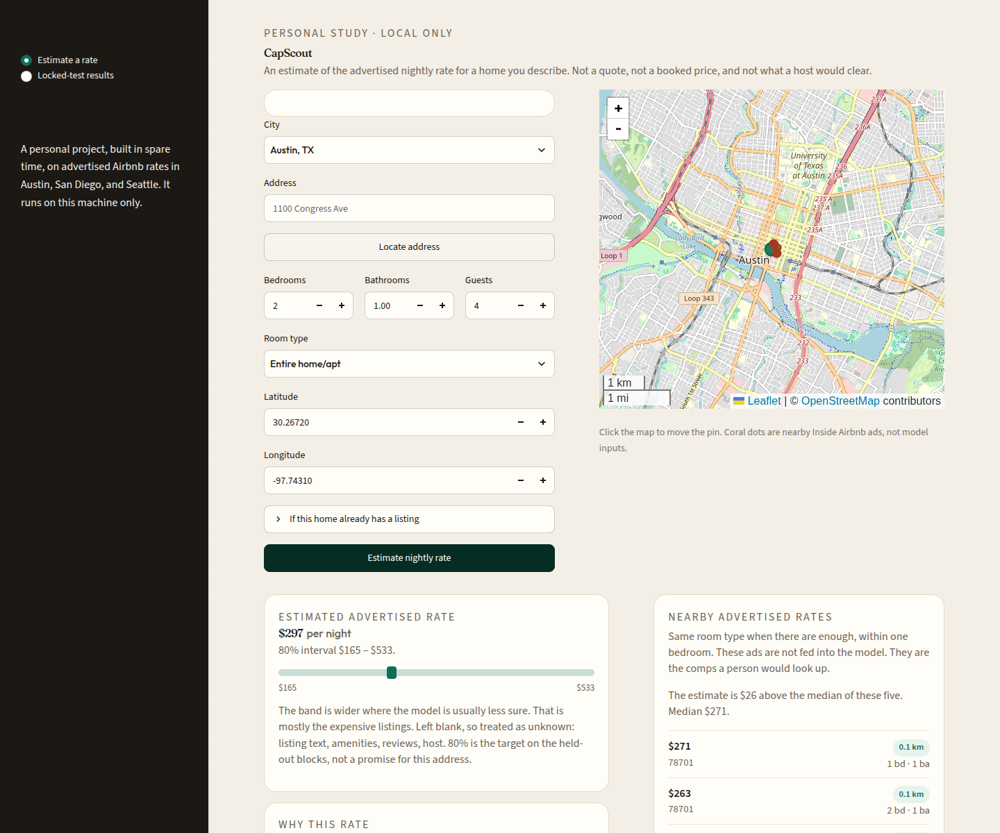

CapScout is a personal project built in Corbin's spare time, for learning and as a portfolio piece. It is not a commercial product.

# CapScout

How close can a public model get to an Airbnb listing's advertised nightly rate, without training on the listing next door or on the same host?

The long version is [reports/FINDINGS.md](reports/FINDINGS.md). The reading that shaped this round is [docs/RESEARCH.md](docs/RESEARCH.md). Sources and licenses are in [DATA.md](DATA.md).

## The result

One locked spatial test per city, the same rows as v2, scored once after the new columns were chosen on other folds. The model is still an equal-weight blend of CatBoost and XGBoost on log price. On top of v2's size, location, census, amenities, and reviews, it adds beds, a shared-bath flag, host response and tenure, the separate review scores, and a few more amenities. Metrics are in dollars.

| City | Test R² | Test MAE | Test RMSE | MAPE | Median APE | 80% coverage | Listings |
| --- | ---: | ---: | ---: | ---: | ---: | ---: | ---: |
| Austin | 0.451 | $83.95 | $156.32 | 32.0% | 27.2% | 73.2% | 2,796 |
| San Diego | 0.675 | $99.52 | $178.94 | 29.8% | 22.5% | 77.1% | 875 |
| Seattle | 0.526 | $38.75 | $74.95 | 27.0% | 21.6% | 83.2% | 2,042 |

v2, on these same rows, was R² 0.422 / 0.678 / 0.532 and MAE $87.74 / $98.96 / $38.19. Austin improved by about $4 a night. San Diego and Seattle each got about $0.50 worse. A refit of the v2 specification in this code matched those published scores exactly, so the gap is the new columns.

A neighbourhood-by-room-type median is worse (MAE $127.68, $187.07, $61.90). The size-and-location specification is still R² 0.344 / 0.523 / 0.458. Development R² for the selected model, on folds that exclude both holdouts, was 0.564 ± 0.082 in Austin, 0.620 ± 0.051 in San Diego, and 0.473 ± 0.183 in Seattle.

Seed 7 had already been published, so it was not used to choose anything. A second holdout, seed 11, was frozen first and scored once. On that check the new columns lowered MAE in every city. Seattle's check is 216 listings. The details are in the findings.

An older pipeline trained on area-median prices and showed R² near 0.97. That was the target being easy. Scored against the listing's own price, the same exercise is about R² 0.385. It is a demonstration, not a result of this study.

## What did not help

A fixed reading of the listing text, a fold-fit TF-IDF of the ad, a 5 km smooth of nearby training prices, a deeper tree, and one model for all three cities did not clear a pre-set 1% bar on development MAE. Photos were not used. The 80% intervals covered 73.2% of Austin's test, 77.1% of San Diego's, and 83.2% of Seattle's. Austin is better than v2's 66.7% and it is not 80%. The band was not widened after that look.

## Data

| Source | License | Used for |
| --- | --- | --- |
| Inside Airbnb listings | CC BY 4.0 | The rows, the price, size, room type, amenities, reviews, host fields, the ad text that was measured and not kept |
| Census ACS 2024 5-year and TIGER/Line tracts | Public domain | Tract income, rent, home value, density |
| OpenStreetMap via Overpass | ODbL, © OpenStreetMap contributors | Measured in v2, not in the scored model |

The calendar file was not used. Unavailable is not the same thing as booked. Redfin, Zillow, and AirDNA were not used. Host photos were not downloaded.

## Reproduce

From the repository root, with the pinned `requirements.txt`:

```bash
pip install -r requirements.txt
python -m evaluation.run_eval
pytest
```

That command rebuilds features, fits the development splits, writes `reports/metrics.json`, and scores the locked test and the confirmation holdout once. Cached city extracts are already in the repo. The evaluation itself is a few minutes on a laptop.

`evaluation/protocol.py` is the design: the test seed, the confirmation seed, the 1 km buffer, the host rule, and the bars for a new feature, a pooled model, and a new interval. Change those and you are running a different study. The held-out listing ids are in `evaluation/locked_test_ids.json` and `evaluation/confirm_ids.json`.

## Run the local app

After the artifacts exist (they are committed, or they appear when the command above finishes):

```bash
streamlit run app/streamlit_app.py
```

The app binds to `127.0.0.1:8501` only. Pick a city, search an address or click the map, enter bedrooms, bathrooms, guests, and room type. It returns a nightly rate, an 80% interval, plain-language reasons, and nearby advertised rates. A listing description, amenities, and reviews are optional. Left blank, they stay missing, which is the right input for a home that has never been listed. A second page shows the locked-test metrics and the figures.



The rate is an advertised-rate estimate. It is not a quote.

## Limitations

- The label is the advertised rate, not what a guest paid.
- The gain over v2 is a few dollars in Austin. San Diego and Seattle did not improve on the locked test.
- Errors of tens of dollars, and intervals a hundred dollars wide, are the honest precision.
- Austin's 80% interval covered 73.2% of the test.
- San Diego's test is 875 listings. Seattle's confirmation check is 216. Those R² figures are one split each.
- Seattle's training set after the buffer is 1,507 listings, against a test of 2,042.
- Three cities, one protocol. This is not a national model.
